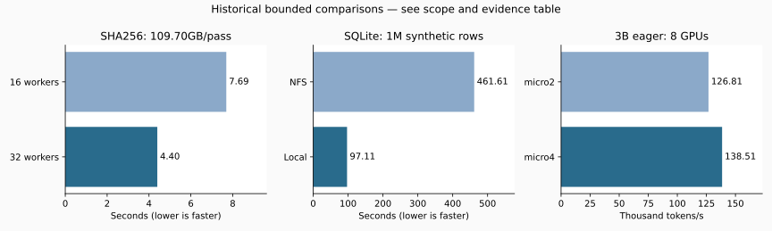

# Optimization experiments / 최적화 실험

These are **historical measurements**, not new benchmarks of the public package. Reports preserve the original scope/status, including rejected or pending candidates. The original machine had 8 H200 GPUs, container CPU capacity96 and memory limit1920GiB; each contract/hardware report supplies the actual case settings. Do not extrapolate short, warm-cache or synthetic measurements to full-corpus performance.

각 실험은 목적·비교 후보·조건·측정 결과·채택/기각 이유를 함께 읽습니다. 속도 향상만으로 수치 정확성·학습 품질 통과를 뜻하지 않습니다. `index.json`의 원본/공개 SHA와 `code_bindings.json`의 당시 코드 연결을 확인하세요. 개인정보 경로와 본문/sample 필드는 변환·제외했고 수치 자체는 보존했습니다.

## Selected measured comparisons

| Experiment | Measurement | Scope / interpretation | Evidence |
|---|---|---|---|
| SHA256 workers16/32 | 7.694s / 4.397s | 32 selected files; 109.70GB/pass; repeated warm-cache shared-host observations; matching hashes | [JSON](results/source_hash_sweep32_v1/report.json) |
| SQLite NFS/local | 461.609s / 97.112s | 1M synthetic rows; cache512MiB; same logical digest; single shared-host comparison | [JSON](results/resource_policy_validation_v1/local_vs_nfs.json) |
| SQLite cache512/8192/131072MiB | 316.882s / 318.339s / 302.857s | 3M synthetic rows; build+verify; upper cache limit != resident RAM; no full-corpus optimum claim | [JSON](results/split_cache_sweep_v1/report.json) |
| Token encoding single/parallel | 73.886s / 18.099s | 512MiB experimental input; identical encodings; four sources, warm cache; final-input pilot separate | [JSON](results/next_stage_optimization_v1/review.json) |
| BPE stream/RAM | 65.461s / 76.234s | Matched512MiB input; RAM includes preload; one observation; RAM candidate slower | [JSON](results/bpe_memory_v1/report.json) |
| 1b actual-token eager throughput | micro4: 346.85k tok/s / micro8: 370.16k tok/s | 8 GPUs; seq4096; 6 timed updates; evaluation/checkpoint costs excluded; model quality not measured | [JSON](results/actual_deterministic_batch_v1/report.json) |
| 3b actual-token eager throughput | micro2: 126.81k tok/s / micro4: 138.51k tok/s | 8 GPUs; seq4096; 6 timed updates; evaluation/checkpoint costs excluded; model quality not measured | [JSON](results/actual_deterministic_batch_v1/report.json) |
| Compile diagnostic 8GPU | -0.556% / +0.089% | Two seeds; numerical diagnostic and production adoption are separate; no useful speedup | [JSON](results/compile_long_v1/review.json) |

## How to reproduce or extend a comparison

1. Find the campaign below and read its `contract.json`, report, and review. Bind source/input identity, seed, model geometry and software environment.
2. Inspect the corresponding `scripts/benchmark_*`, `probe_*` or `validate_*` CLI and use an explicit new output directory. GPU recipes require the indicated devices and input data, which are not bundled.
3. Measure total elapsed including the same validation/publication boundaries; report warmup/compile cost separately. Preserve restart/output equivalence and compare memory as well as time.
4. Report all measured candidates and unsuccessful attempts. A missing historical source hash is explicitly unresolved in `code_bindings.json`, not silently replaced with current code.

The large GPU/data campaigns are not executed by CI. `python experiments/render_summary.py` rebuilds this table from included JSON only. With `requirements-bench.txt`, it also creates the SVG below.

## Campaign index

| Campaign | Result files | Historical code snapshots |
|---|---:|---:|
| [actual_batch_v1](results/actual_batch_v1/) | 4 | 0 |
| [actual_deterministic_batch_v1](results/actual_deterministic_batch_v1/) | 4 | 0 |
| [actual_pilot_input_v1](results/actual_pilot_input_v1/) | 1 | 0 |
| [actual_train_validation_v1](results/actual_train_validation_v1/) | 2 | 0 |
| [bpe_memory_v1](results/bpe_memory_v1/) | 3 | 0 |
| [c2_validation_v1](results/c2_validation_v1/) | 1 | 0 |
| [c2_validation_v2](results/c2_validation_v2/) | 1 | 0 |
| [compile_boundaries_v1](results/compile_boundaries_v1/) | 2 | 0 |
| [compile_casts_v1](results/compile_casts_v1/) | 2 | 0 |
| [compile_long_v1](results/compile_long_v1/) | 3 | 0 |
| [compile_pair_v1](results/compile_pair_v1/) | 3 | 0 |
| [compile_precision_v1](results/compile_precision_v1/) | 3 | 0 |
| [eager_norm_casts_v1](results/eager_norm_casts_v1/) | 2 | 0 |
| [f4_completion_watch_v1](results/f4_completion_watch_v1/) | 2 | 0 |
| [f4_full_v1](results/f4_full_v1/) | 1 | 0 |
| [f4_full_v2](results/f4_full_v2/) | 2 | 0 |
| [f4_prefetch_v1](results/f4_prefetch_v1/) | 2 | 1 |
| [f4_read_probe_v1](results/f4_read_probe_v1/) | 3 | 0 |
| [f4_scale3m_v1](results/f4_scale3m_v1/) | 2 | 0 |
| [f5_tokenizer_v1](results/f5_tokenizer_v1/) | 2 | 14 |
| [f6_pilot_threads_v1](results/f6_pilot_threads_v1/) | 3 | 1 |
| [f6_token_prefetch_v1](results/f6_token_prefetch_v1/) | 2 | 1 |
| [f6_tokens_v1](results/f6_tokens_v1/) | 5 | 13 |
| [final_resume_probe_preparation_v1](results/final_resume_probe_preparation_v1/) | 2 | 0 |
| [full_fp32_gate_v1](results/full_fp32_gate_v1/) | 2 | 0 |
| [gpu_benchmark_v2](results/gpu_benchmark_v2/) | 1 | 0 |
| [gpu_benchmark_v3](results/gpu_benchmark_v3/) | 4 | 0 |
| [gpu_sweep_20261105T125309Z](results/gpu_sweep_20261105T125309Z/) | 1 | 0 |
| [monitored_3b_validation_v1](results/monitored_3b_validation_v1/) | 3 | 0 |
| [n2_compile_v1](results/n2_compile_v1/) | 1 | 0 |
| [next_stage_optimization_v1](results/next_stage_optimization_v1/) | 5 | 0 |
| [nfs_checkpoint_validation_v1](results/nfs_checkpoint_validation_v1/) | 2 | 0 |
| [normalization_v1](results/normalization_v1/) | 1 | 0 |
| [performance_tuning_v1](results/performance_tuning_v1/) | 1 | 7 |
| [pretrain_final_review_v1](results/pretrain_final_review_v1/) | 2 | 0 |
| [resource_policy_validation_v1](results/resource_policy_validation_v1/) | 1 | 1 |
| [source_hash_sweep32_v1](results/source_hash_sweep32_v1/) | 2 | 0 |
| [source_hash_sweep_v1](results/source_hash_sweep_v1/) | 2 | 1 |
| [split_cache_sweep_v1](results/split_cache_sweep_v1/) | 2 | 0 |
| [split_distribution_indexed_v1](results/split_distribution_indexed_v1/) | 2 | 0 |
| [split_distribution_native3m_local_v1](results/split_distribution_native3m_local_v1/) | 3 | 0 |
| [split_distribution_native3m_v1](results/split_distribution_native3m_v1/) | 1 | 0 |
| [split_hotpath_v1](results/split_hotpath_v1/) | 2 | 0 |
| [split_scale_v1](results/split_scale_v1/) | 1 | 0 |
| [swiglu_rounding_v1](results/swiglu_rounding_v1/) | 1 | 0 |
| [tiered_retention_copy_v1](results/tiered_retention_copy_v1/) | 1 | 0 |
| [tiered_retention_copy_v2](results/tiered_retention_copy_v2/) | 1 | 0 |

Historical code objects are under `code/<sha256>.py`; `index.json` maps each to its original path. They are source evidence, not supported standalone CLI entrypoints. Results can reference excluded input files/DBs/checkpoints; those paths document the original experiment and are not promised downloads.
